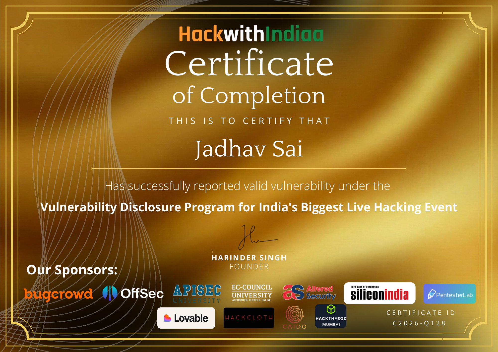
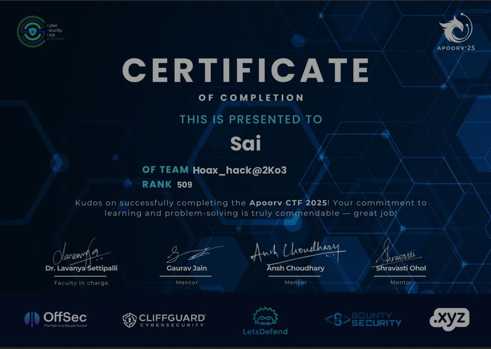

<h1 align="center">Hi, I'm Jadhav Sai 👋</h1>

  <b>4th Year CS Student &nbsp;|&nbsp; Aspiring Penetration Tester &nbsp;|&nbsp; Red Teamer in Progress</b>

  Learning offensive security hands-on — through real projects, CTF competitions, bug bounty findings, and continuous lab practice.

  
  &nbsp;
  
  &nbsp;
  

---

## 🚀 Projects — Attack & Investigation

| Project | Description | Tools Used |
|---|---|---|
| [🔍 Digital Forensics — Remote Attack Investigation](https://github.com/jadhav1919/Digital-Forensics-Remote-Attack-Investigation) | Full multi-stage cyber attack — remote access, data exfiltration, false flag planting, anti-forensics, memory & disk forensics | Volatility, Magnet AXIOM, FTK Imager, Metasploit, Mimikatz |
| [🔐 SSH Brute Force Forensics Lab](https://github.com/jadhav1919/SSH-bruteforce-forensics-lab) | SSH brute-force attack simulation with packet capture, log analysis, and forensic investigation | Hydra, Wireshark, tcpdump |
| [⛓️ IDS Blockchain System](https://github.com/jadhav1919/IDS-Blockchain-System) | Simulated IDS with blockchain-based alert logging and live dashboard | Python |

---

## 🏆 CTF & Bug Bounty Achievements

### 🥇 HackWithIndia 2026 — Valid Vulnerability Report

> **Certificate ID: C2026-Q128** &nbsp;|&nbsp; Vulnerability Disclosure Program &nbsp;|&nbsp; India's Biggest Live Hacking Event
> Signed by: Harinder Singh, Founder

View Certificate

---

### 🥈 Apoorv CTF 2025

> **Team: Hoax_hack@2Ko3** &nbsp;|&nbsp; **Rank: 509**
> Faculty: Dr. Lavanya Settipalli &nbsp;|&nbsp; Mentors: Gaurav Jain, Ansh Choudhary, Shravasti Ohol

View Certificate

---

### 🐛 Bug Bounty — [Bugcrowd Profile](https://bugcrowd.com/h/JadhavSai)

- Findings: **IDOR, CORS misconfiguration, missing security headers, path traversal** — all with structured reproduction steps
- PortSwigger: SQLi (all 18 beginner labs), XSS, IDOR, SSRF — intercepted and modified with Burp Suite
- DVWA exploitation at LOW / MEDIUM / HIGH security: SQL injection, XSS, CSRF, file upload, command injection

---

## 🧪 Practical Notes — Ethical Hacking Labs

| Repository | What's Inside |
|---|---|
| [📡 Information-Gathering](https://github.com/jadhav1919/Information-Gathering) | 27 tools — Google Dorking, GHDB, Shodan, theHarvester, Sherlock, Maltego, recon-ng, OSINT framework |
| [🌐 Network-scanning](https://github.com/jadhav1919/Network-scanning) | OS discovery, port & service discovery, IDS/firewall evasion — Nmap, Hping3, Metasploit |
| [🔎 Enumeration](https://github.com/jadhav1919/Enumeration) | 9 protocol types — NetBIOS, RPC, SMB, SNMP, LDAP, NTP, NFS, SMTP, DNS, IPSec, VoIP |
| [💻 OverTheWire](https://github.com/jadhav1919/OverTheWire) | Wargame walkthroughs — Linux, cybersecurity, and penetration testing concepts |

---

## 🕷️ PortSwigger Web Security Academy

> Continuously practicing and adding labs — this section grows as I learn.

| Repository | Status |
|---|---|
| [SQL-Injection](https://github.com/jadhav1919/SQL-Injection) | 🔄 In Progress — 18 beginner labs done, continuing |
| [Authentication-vulnerabilities](https://github.com/jadhav1919/Authentication-vulnerabilities) | 🔄 In Progress — auth bypass techniques and lab solutions |
| [Path-Traversal](https://github.com/jadhav1919/Path-Traversal) | 🔄 In Progress — notes and walkthroughs documented |
| [access-control](https://github.com/jadhav1919/access-control) | 🔄 In Progress — notes, labs, screenshots, and solutions |
| XSS, IDOR, SSRF, CSRF | 🔜 Continuing — practiced with Burp Suite, more labs being added |

---

## 📈 TryHackMe Learning Progress

  

| Status | Path |
|---|---|
| ✅ Done | [Pre-Security](https://github.com/jadhav1919/Pre-Security) |
| ✅ Done | [Cyber Security 101](https://github.com/jadhav1919/Cyber-Security-101) |
| 🔄 In Progress | Jr Penetration Tester |
| 🔜 Planned | Web Application Pentesting |
| 🔜 Planned | Web Application Red Teaming |
| 🔜 Planned | Red Teaming |

---

## 🛠️ Skills & Tools

**Operating Systems**

**Languages**

**Offensive Tools**

**Forensics Tools**

**Security Skills**

`SQL Injection` `XSS` `IDOR` `SSRF` `CSRF` `Path Traversal` `Auth Bypass` `Access Control` `CORS Misconfiguration` `Cryptography` `Steganography` `CVE Research` `Memory Forensics` `Disk Forensics` `False Flag Analysis` `Anti-Forensics Detection` `Privilege Escalation` `Persistence Mechanisms`

---

  <i>"Documenting the journey, one vulnerability at a time."</i>

